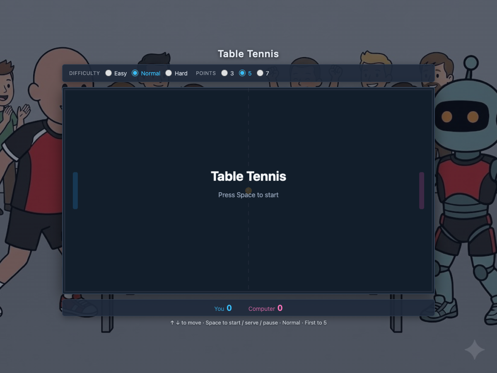

# Table Tennis Game

A browser-based table tennis game built as a single HTML file. Play against the computer, move your paddle with the arrow keys, and try to outsmart an AI opponent with spin, speed, and strategy.

**Live demo:** [primayuda.dev/pingpong-game](https://primayuda.dev/pingpong-game/)



## About This Project

This game was built while exploring AI-assisted development workflows. It started as a simple canvas game and grew into a polished mini-project with difficulty levels, spin physics, sound effects, and Cloudflare deployment.

The project is inspired by coursework on [DeepLearning.AI](https://www.deeplearning.ai/) by **Andrew Ng**, as part of learning to build software with AI tools and modern deployment practices.

**Developer:** [primayuda.dev](https://primayuda.dev)

## Features

- **Single-file game** — HTML, CSS, and JavaScript in one file (`pingpong.html`)
- **Player vs computer** — You on the left, AI on the right
- **Controls** — `↑` / `↓` to move, `Space` to start, serve, and pause
- **Difficulty levels**
  - **Easy** — Smaller AI paddle, slower reactions
  - **Normal** — Balanced gameplay
  - **Hard** — Smaller player paddle, faster ball, aggressive AI, stronger spin
- **Spin physics** — Off-center hits and paddle movement add spin and unpredictable ball paths
- **Sound effects** — Paddle hits, wall bounces, scoring, and win/lose jingles (Web Audio API)
- **Configurable match length** — First to 3, 5, or 7 points
- **Responsive layout** — Canvas scales to fit the screen

## Play Locally

Open the file directly in your browser:

```bash
git clone https://github.com/primayuda/pingpong-game.git
cd pingpong-game
open pingpong.html
```

Or serve it locally:

```bash
python3 -m http.server 8080
# Visit http://localhost:8080/pingpong.html
```

## Deploy

The project is deployed to Cloudflare Workers with static assets.

```bash
npm install
npm run deploy
```

Production URL: [https://primayuda.dev/pingpong-game/](https://primayuda.dev/pingpong-game/)

Pushes to the `main` branch on GitHub trigger an automatic Cloudflare build when Git integration is enabled.

## Project Structure

```text
pingpong-game/
├── pingpong.html          # Source of truth for the game
├── public/
│   └── pingpong-game/
│       └── index.html     # Deployed copy (synced via npm run build)
├── docs/
│   └── screenshot.png     # README screenshot
├── wrangler.jsonc         # Cloudflare Workers config
└── package.json
```

## Tech Stack

- Vanilla HTML / CSS / JavaScript
- HTML Canvas for rendering and game loop
- Web Audio API for sound
- Cloudflare Workers (static assets)
- GitHub + Cloudflare CI for auto-deploy

## License

Personal project — feel free to explore the code and learn from it.
